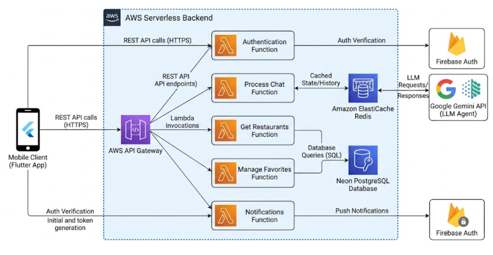

# Restaurant Proximity Service

A mobile app to search for restaurants in an easy and personalized way, with an integrated agent for natural language interaction.

<br>

## Description

Built on a serverless architecture, the backend uses AWS Lambda (Node.js) routed through AWS API Gateway, Neon Database with hybrid manageable and scalable memory for the agent and application. ElastiCache Redis handles the in-memory layer for fast state and caching, while the mobile application is developed with Flutter and Dart, using Hive for local cache management.

<br>

## Table of Contents

- [Restaurant Proximity Service](#restaurant-proximity-service)
  - [Description](#description)
  - [Table of Contents](#table-of-contents)
  - [1- Properties](#1--properties)
    - [1.1- Key Features](#11--key-features)
    - [1.2- Interface](#12--interface)
      - [Views](#views)
      - [Screenshots](#screenshots)
    - [1.3- Requirements](#13--requirements)
      - [Functional Requirements](#functional-requirements)
      - [Non-Functional Requirements](#non-functional-requirements)
  - [2- Architecture](#2--architecture)
    - [2.1- Diagram](#21--diagram)
    - [2.2- System Performance \& Scalability Design](#22--system-performance--scalability-design)
      - [Client \& Caching Strategy](#client--caching-strategy)
      - [Infrastructure \& API Layer](#infrastructure--api-layer)
      - [Database \& Storage Layer (Neon PostgreSQL)](#database--storage-layer-neon-postgresql)
      - [Serverless Compute (AWS Lambda)](#serverless-compute-aws-lambda)
      - [AI Agent Memory Architecture](#ai-agent-memory-architecture)
    - [2.3- Tech Stack](#23--tech-stack)
      - [Tools](#tools)
      - [Packages](#packages)
      - [Standardization](#standardization)
    - [2.4- Folder Structure (Feature-First)](#24--folder-structure-feature-first)
      - [Frontend/](#frontend)
      - [Backend/](#backend)
  - [3- Development and Execution Guide](#3--development-and-execution-guide)
    - [3.1- Setup Environment](#31--setup-environment)
      - [Pre-Requisites](#pre-requisites)
    - [3.2 Local Execution](#32-local-execution)
      - [Frontend](#frontend-1)
      - [Backend](#backend-1)

<br>

## 1- Properties

### 1.1- Key Features

- **Map:** Interactive map for realtime geospatial exploration
- **Filters:** To find places on the map with specific properties
- **Chat LLM Agent:** To attend requests in natural language
- **Favorite Places:** To bookmark special locations and details
- **Discover:** To receive recommendations of restaurants

### 1.2- Interface

#### Views

- **Home:** Home page with an interactive map featuring search and filter options
- **Chat:** Direct chat with the agent for natural language and setup preferences
- **Favorites:** Saved restaurants with cards for restaurants with their details
- **Discover:** Sections with carousel of cards with recommended restaurants with certain properties
- **Settings:** Parameters of account, dark theme, change of email or password, logout
- **Notifications:** Personalized settings for alerts of restaurants

#### Screenshots

|     Home     |      Chat    |   Favorites  |   Discover   |
| :----------: | :----------: | :----------: | :----------: |
|||||

|    Filters   |   Settings   | Notifications|  Dark Mode   | 
| :----------: | :----------: | :----------: | :----------: |
|||||

### 1.3- Requirements

#### Functional Requirements

- **FR-01:** The system must allow users to explore nearby restaurants on an interactive map using real-time geolocation.
- **FR-02:** The system must allow users to search and filter restaurants by custom criteria, labels and natural language.
- **FR-03:** The system must provide a LLM agent capable of processing natural language, queries and user preference configurations.
- **FR-04:** The agent must store and retrieve user preferences to deliver personalized responses.
- **FR-05:** The agent must manage conversational context and chat history with a 24-hour TTL ephemeral memory using Redis.
- **FR-06:** The system must allow users to save, view, and remove restaurants from their personal favorites list.
- **FR-07:** The system must display curated restaurant recommendations and carousels within the discover section based on user context.
- **FR-08:** The system must allow users to manage account parameters, change security credentials, and toggle between dark and light UI themes.
- **FR-09:** The system must deliver personalized notification settings and alerts for restaurant alerts.
- **FR-10:** The application must cache session data, user preferences, and bookmarks locally via Hive to accelerate UI rendering.
- **FR-11:** The serverless API layer must handle exceptions asynchronously using standard HTTP response wrappers to maintain API gateway stability.

#### Non-Functional Requirements

- **NFR-01: Performance:** The Flutter mobile client must sustain a render speed of 60 FPS during map panning, screen transitions, and navigation.
- **NFR-02: Latency:** The LLM conversational agent and geospatial endpoints must deliver API responses with sub-second latencies using Redis caching.
- **NFR-03: Scalability:** The backend infrastructure must scale dynamically using AWS Lambda and Neon Serverless Database under burst connection loads.
- **nfr-04: Optimization:** The application must have hybrid memory management for faster responses
- **NFR-05: Compatibility:** The mobile application must natively support both iOS and Android platforms.
- **NFR-06: Security:** All client-server communications must be encrypted in transit via HTTPS through AWS API Gateway, with JWT authentication using firebase.

<br>

## 2- Architecture

### 2.1- Diagram



### 2.2- System Performance & Scalability Design

#### Client & Caching Strategy

- **Local Persistence:** Hive for ultra-fast local storage (agent preferences, session state, offline tokens).
- **Asset Caching:** `cached_network_image` for LRU disk/memory caching of restaurant imagery.
- **UI State & UX:** `flutter_bloc` for isolated widget re-renders with lazy loading & infinite scrolling on discovery maps and list views.

#### Infrastructure & API Layer

- **IaC & Deployment:** Modular Terraform for AWS persistent infrastructure combined with AWS SAM for serverless function testing and Canary deployments.
- **Asynchronous Task Queue:** AWS SQS for decoupling push notifications, analytics, and heavy background processing.
- **Traffic Control:** Rate limiting and throttling enforced at the API Gateway layer to protect backend Lambdas.

#### Database & Storage Layer (Neon PostgreSQL)

- **Connection Management:** Connection pooling via PgBouncer to sustain high-concurrency Lambda bursts without port exhaustion.
- **Compute Efficiency:** Autosuspend and Autoresume enabled for dynamic traffic-based resource scaling.

#### Serverless Compute (AWS Lambda)

- **Architecture:** `arm64` (AWS Graviton2) execution environment for optimized cost-performance ratio.
- **Connection Reuse:** Database (`pg`) and Redis (`ioredis`) clients instantiated outside handlers for warm invocation reuse.
- **Networking:** HTTP Keep-Alive enabled for low-latency TLS handshakes with LLM services.
- **Low-Latency Streaming:** Response Streaming enabled for fast Time-To-First-Token (TTFT) user experience in chat interactions.

#### AI Agent Memory Architecture

- **Ephemeral Context:** Redis with 24-hour TTL for instant short-term conversational context and state.
- **Persistent Chat Storage:** Neon PostgreSQL for long-term historical records.
- **Semantic Retrieval:** Vectorized embeddings using `pgvector` in Neon for RAG-based preference matching.

### 2.3- Tech Stack

#### Tools

- **Frontend:** Flutter Framework, Dart Language
- **Backend Runtime:** Node.js, AWS Lambda (Serverless)
- **Database:** Neon PostgreSQL Serverless
- **In-Memory Cache:** Amazon ElastiCache (Redis)
- **API Management:** AWS API Gateway
- **Local Storage:** Hive

#### Packages

**Client**
- SDK: Flutter SDK with `dart`
- State Management: `flutter_bloc`
- Navigation: `go_router`
- Dependency Injection: `get_it`
- Local Cache: `hive`, `hive_flutter`, `build_runner`
- Data Models & Serialization: `freezed`, `json_serializable`
- Geospatial & Maps: `google_maps_flutter`, `geolocator`
- Network & Media: `dio`, `cached_network_image`
- Authentication: `firebase_auth`

**Infrastructure & Backend**
- Infrastructure as Code (IaC): `terraform`
- Cache & Sessions: Redis (`ioredis` / `@redis/client`)
- Database ORM / Driver: `drizzle-orm` (or `prisma`), `@neondatabase/serverless`
- Schema Validation: `zod`, `fastify-type-provider-zod`
- AI Agent & Orchestration: Google Gemini API (`@google/genai`), Groq API / Ollama (Hybrid Fallback)
- Authentication: `firebase-admin` (JWT verification)
- Bundling & SDKs: `esbuild`, `@aws-sdk/client-*`

**DevOps**
- Deployment & Serverless Testing: AWS SAM
- Local Infrastructure: Docker & Docker Compose
- Version Control: Git with `conventional commits`
- Static Analysis & Linters: `flutter_lints`, `dart format`, `prettier`, `hadolint`, `tflint`

#### Standardization

- Google design rules with `flutter_lints`
- Automatic formatting with `dart format` and `prettier`
- Commit messages with `conventional commits`

### 2.4- Folder Structure (Feature-First)

#### Frontend/

```
lib/
  app/                  # global settings, routes and themes
    config/             # endpoints and variables 
    router/             # screen routes
    theme/              # color variables, palette and themes
  core/                 # shared logic between features
    location/           # distance calculations, geolocation
    network/            # http client and api endpoints
    storage/            # local storage
    utils/              # extensions, helpers
    widgets/            # shared components
  features/             # bussiness logic separated by features
    map/                # search map logic
    agent/              # llm use cases, chat history
    restaurants/        # shared logic with data
    settings/           # profile, auth state, account
    notifications/      # alert preferences
```

#### Backend/

```
src/
  api/                  # lambda entrypoints
    auth/               # authentication
    restaurants/        # endpoints to get data from places
    favorites/          # endpoints for storaged restaurants
    agent/              # endpoints for llm
  core/                 # config, constants and errors
  infrastructure/       # services and databases
  models/               # interfaces and types restaurant, user, chat
  orchestrator/         # agent logic and function calling
```

<br>

## 3- Development and Execution Guide

### 3.1- Setup Environment

#### Pre-Requisites

- Flutter SDK `>=3.19.0`
- Dart SDK `>=3.3.0`
- Node.js `>=18.x.x` & npm/pnpm
- Docker & Docker Compose
- AWS CLI configured
- Android Studio / Xcode

### 3.2 Local Execution

#### Frontend

- Go frontend folder `cd app`
- Clean cache `flutter clean`
- Install dependencies `flutter pub get`
- Static code analysis `flutter analyze`
- Run Unit Tests `flutter test`
- Run project `flutter run`

#### Backend

- Go to backend folder `cd backend`
- Install dependencies `npm install`
- Setup environment variables `cp .env.example .env`
- Start local infrastructure `docker compose up -d`
- Run local database `npm run migrate`
- Start local serverless backend `npm run dev`