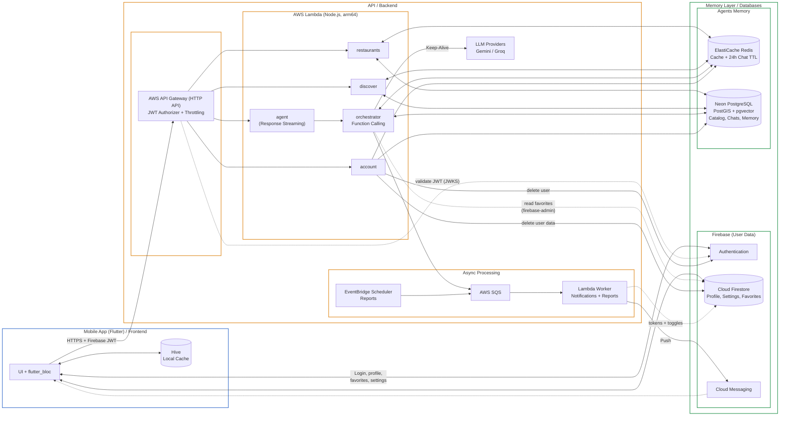
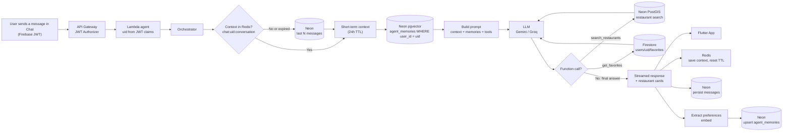
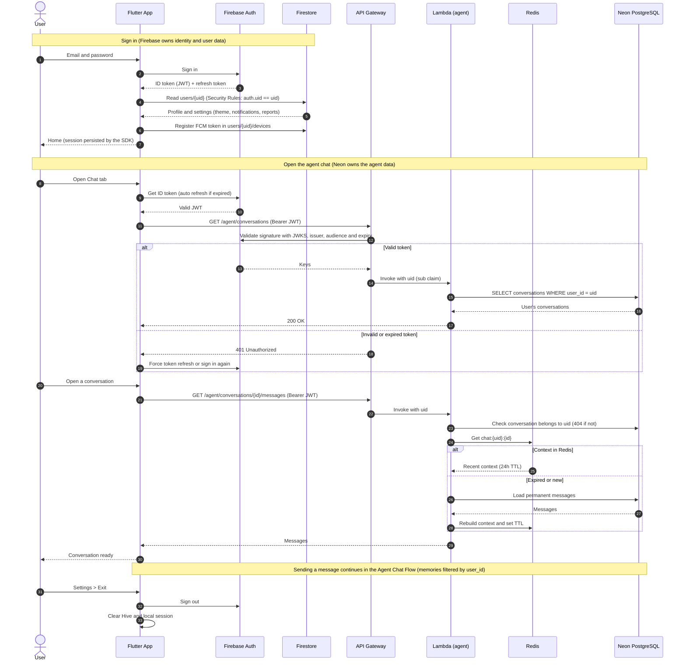
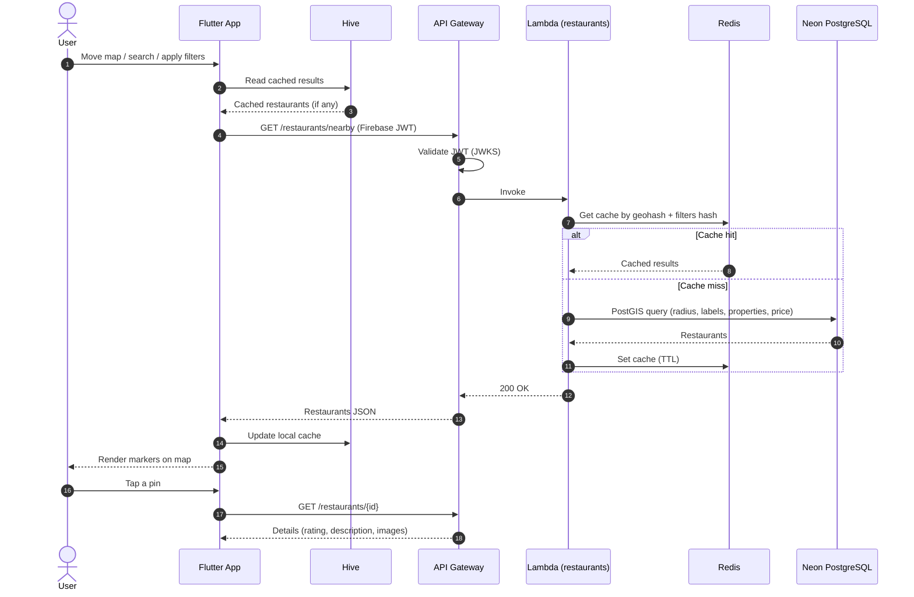
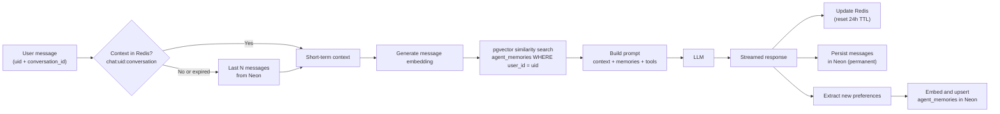
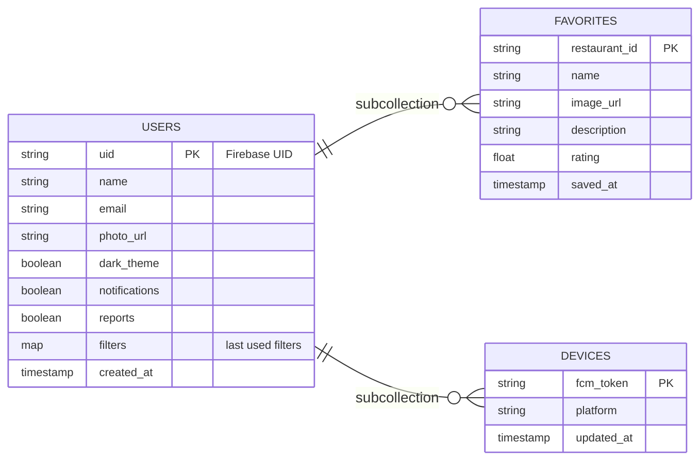
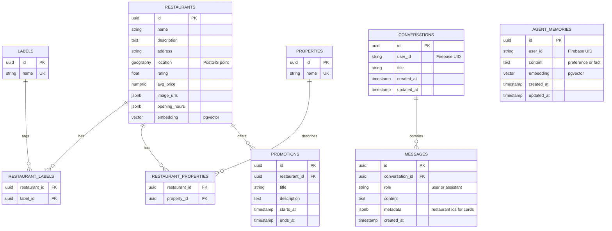
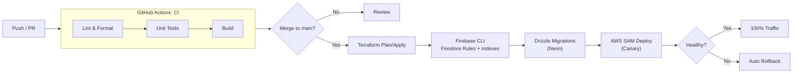

# Restaurant Proximity Service 

A mobile app to search for restaurants in an easy and personalized way, with an integrated agent for natural language interaction.

<br>

## Description

Built on a serverless architecture with a dual-database model, Firebase Auth handles user data, while Neon Serverless PostgreSQL manages the restaurant catalog, PostGIS spatial data, and the agent's semantic long-term memory. 

The backend relies on AWS Lambda (Node.js) routed through AWS API Gateway for Firebase JWT validation and response streaming. ElastiCache Redis powers the in-memory layer for 24-hour TTL ephemeral chat context and geospatial query caching. The mobile client is developed with Flutter and Dart, using Hive for local persistence.

<br>

## Table of Contents

- [Restaurant Proximity Service ](#restaurant-proximity-service-)
  - [Description](#description)
  - [Table of Contents](#table-of-contents)
  - [1- Properties](#1--properties)
    - [1.1- Key Features](#11--key-features)
    - [1.2- Interface](#12--interface)
      - [Views](#views)
      - [Screenshots](#screenshots)
    - [1.3- Requirements](#13--requirements)
      - [Functional Requirements](#functional-requirements)
      - [Non-Functional Requirements](#non-functional-requirements)
  - [2- Architecture](#2--architecture)
    - [2.1- Diagram](#21--diagram)
      - [Architecture Overview](#architecture-overview)
      - [Agent Chat Flow](#agent-chat-flow)
      - [Authentication Flow](#authentication-flow)
      - [Nearby Search Flow](#nearby-search-flow)
    - [2.2- System Performance \& Scalability Design](#22--system-performance--scalability-design)
      - [Client \& Caching Strategy](#client--caching-strategy)
      - [Infrastructure \& API Layer](#infrastructure--api-layer)
      - [User Data Layer (Firebase)](#user-data-layer-firebase)
      - [Database \& Storage Layer (Neon PostgreSQL)](#database--storage-layer-neon-postgresql)
      - [Serverless Compute (AWS Lambda)](#serverless-compute-aws-lambda)
      - [AI Agent Memory Architecture](#ai-agent-memory-architecture)
    - [2.3- Tech Stack](#23--tech-stack)
      - [Tools](#tools)
      - [Packages](#packages)
      - [Standardization](#standardization)
    - [2.4- Folder Structure (Feature-First)](#24--folder-structure-feature-first)
      - [Frontend/](#frontend)
      - [Backend/](#backend)
    - [2.5- Data Model](#25--data-model)
      - [Cloud Firestore (User Data)](#cloud-firestore-user-data)
      - [Neon PostgreSQL (Catalog \& Agent)](#neon-postgresql-catalog--agent)
      - [Redis (Ephemeral)](#redis-ephemeral)
    - [2.6- API Reference](#26--api-reference)
      - [Backend REST API (Lambda)](#backend-rest-api-lambda)
      - [Firebase SDK (Client)](#firebase-sdk-client)
  - [3- Development and Execution Guide](#3--development-and-execution-guide)
    - [3.1- Setup Environment](#31--setup-environment)
      - [Pre-Requisites](#pre-requisites)
    - [3.2 Local Execution](#32-local-execution)
      - [Frontend](#frontend-1)
      - [Backend](#backend-1)
    - [3.3- Environment Variables](#33--environment-variables)
    - [3.4- CI/CD and Deployment](#34--cicd-and-deployment)

<br>

## 1- Properties

### 1.1- Key Features

- **Discover | Home:** To receive recommendations of restaurants
- **Map | Explore:** Interactive map for realtime geospatial exploration
- **Filters:** To find places on the map with specific properties
- **Chat LLM Agent:** To attend requests in natural language
- **Save Places | Favorites:** To bookmark special locations and details

### 1.2- Interface

#### Views

- **Home:** Home page with recomendations of the day, promotions and places by preference
- **Explore:** Page with an interactive map featuring search and filter options
- **Filters:** Personalized settings to filter restaurants
- **Chat:** Direct chat with the agent for natural language and setup preferences
- **Favorites:** Saved restaurants with cards for restaurants with their details
- **Settings:** Parameters of account, dark theme, change of email or password, logout

#### Screenshots

|     Home     |      Explore    |   Filters  |   Chat   |
| :----------: | :----------: | :----------: | :----------: |
|||||

|    Favorites   |   Settings   |  Dark Mode   | 
| :----------: | :----------: | :----------: |
||||

### 1.3- Requirements

#### Functional Requirements

- **FR-01:** The system must allow users to explore nearby restaurants on an interactive map using real-time geolocation, and to open a location details sheet with rating, description and images.
- **FR-02:** The system must allow users to search and filter restaurants by labels, radius, time of arrival, properties, price range and natural language.
- **FR-03:** The system must provide a LLM agent capable of processing natural language, queries and user preference configurations, and able to return restaurant cards inside the chat.
- **FR-04:** The agent must store user preferences as vectorized parameters in Neon (`pgvector`) and retrieve them per user to deliver personalized responses.
- **FR-05:** The agent must manage the immediate conversational context with a 24-hour TTL ephemeral memory using Redis.
- **FR-06:** The agent must store every conversation permanently in Neon, scoped to the authenticated user, allowing each user to list, resume and delete their own conversations.
- **FR-07:** The system must allow users to save, view, and remove restaurants from their personal favorites list, stored per user in Firebase.
- **FR-08:** The system must display on Home the recommendations of the day, promotions and places by user preference in sections with carousels.
- **FR-09:** The system must allow users to sign up, sign in and sign out with Firebase Authentication.
- **FR-10:** The system must allow users to manage account parameters (change name, email and password), delete their account with all their data, and toggle between dark and light UI themes.
- **FR-11:** The system must allow users to enable or disable notifications (personalized recommendations and alerts for restaurants) and reports from Settings.
- **FR-12:** The application must cache recommendations, active filters, theme and recent chat messages locally via Hive to accelerate UI rendering, while Firestore offline persistence keeps favorites and settings available.
- **FR-13:** The serverless API layer must handle exceptions asynchronously using standard HTTP response wrappers to maintain API gateway stability.

#### Non-Functional Requirements

- **NFR-01: Performance:** The Flutter mobile client must sustain a render speed of 60 FPS during map panning, screen transitions, and navigation.
- **NFR-02: Latency:** The geospatial endpoints must deliver API responses with sub-second latencies using Redis caching, and the LLM conversational agent must deliver the first token in under one second using response streaming.
- **NFR-03: Scalability:** The backend infrastructure must scale dynamically using AWS Lambda, Neon Serverless Database and Firebase under burst connection loads.
- **NFR-04: Optimization:** The application must have hybrid memory management for faster responses, permanent chats in Neon, immediate memory in Redis with TTL and vectorized parameters in Neon for persistent agent memory.
- **NFR-05: Compatibility:** The mobile application must natively support both iOS and Android platforms.
- **NFR-06: Security:** All communications must be encrypted in transit via HTTPS through AWS API Gateway, with JWT using Firebase validated at the gateway, with every Neon and Redis record scoped by the Firebase UID.
- **NFR-07: Privacy:** Deleting an account must erase the user's data in Firebase (Authentication and Firestore), Neon (conversations, messages and memories), Redis and the local Hive cache.

<br>

## 2- Architecture

### 2.1- Diagram

#### Architecture Overview




#### Agent Chat Flow



#### Authentication Flow



#### Nearby Search Flow



### 2.2- System Performance & Scalability Design

#### Client & Caching Strategy

- **Local Persistence:** Hive for ultra-fast local storage (recommendations, active filters, theme, recent chat messages).
- **Offline Data:** Firestore offline persistence for favorites, profile and settings.
- **Asset Caching:** `cached_network_image` for LRU disk/memory caching of restaurant imagery.
- **UI State & UX:** `flutter_bloc` for isolated widget re-renders with lazy loading & infinite scrolling on home sections, map and list views.

#### Infrastructure & API Layer

- **IaC & Deployment:** Modular Terraform for AWS persistent infrastructure combined with AWS SAM for serverless function testing and Canary deployments. Firebase rules and indexes are deployed with the Firebase CLI.
- **Asynchronous Task Queue:** AWS SQS for decoupling push notifications, periodic reports, and heavy background processing. EventBridge Scheduler triggers the reports.
- **Authentication at the Edge:** API Gateway JWT authorizer validates the Firebase token before invoking any Lambda; the Firebase UID (`sub` claim) identifies the user in every request.
- **Traffic Control:** Rate limiting and throttling enforced at the API Gateway layer to protect backend Lambdas.

#### User Data Layer (Firebase)

- **Authentication:** Firebase Authentication handles sign up, sign in, email and password changes, and token issuing.
- **Per-User Data:** Cloud Firestore stores profile, settings and favorites per user.
- **Isolation:** Firestore Security Rules allow each user to read and write only their own documents.

#### Database & Storage Layer (Neon PostgreSQL)

- **Scope:** Restaurant details and everything related to the agent does not store credentials or profile data.
- **Connection Management:** Connection pooling via PgBouncer to sustain high-concurrency Lambda bursts without port exhaustion.
- **Compute Efficiency:** Autosuspend and Autoresume enabled for dynamic traffic-based resource scaling.
- **Data Ownership:** Every agent table is keyed per user there are no cross-database foreign keys.

#### Serverless Compute (AWS Lambda)

- **Architecture:** arm64 execution environment for optimized cost-performance ratio.
- **Connection Reuse:** Database and Redis clients instantiated outside handlers for warm invocation reuse.
- **Networking:** HTTP Keep-Alive enabled for low-latency TLS handshakes with LLM services.
- **Low-Latency Streaming:** Response Streaming enabled for fast TTFT user experience in chat interactions.

#### AI Agent Memory Architecture

- **Ephemeral Context:** Redis with 24-hour TTL for instant short-term conversational context and state (immediate memory of the agent).
- **Persistent Chat Storage:** Neon PostgreSQL for permanent conversations and messages, one set per user.
- **Semantic Retrieval:** Vectorized embeddings in Neon as persistent memory of the agent, for RAG-based preference matching.



### 2.3- Tech Stack

#### Tools

- **Frontend:** Flutter Framework, Dart Language
- **Backend Runtime:** Node.js, AWS Lambda (Serverless)
- **Authentication & User Data:** Firebase Authentication, Cloud Firestore
- **Database (Catalog & Agent):** Neon PostgreSQL Serverless
- **Geospatial & Vector Search:** PostGIS, `pgvector`
- **In-Memory Cache:** Amazon ElastiCache (Redis)
- **API Management:** AWS API Gateway (HTTP API with JWT authorizer)
- **Push Notifications:** Firebase Cloud Messaging
- **Scheduling & Queues:** Amazon EventBridge Scheduler, AWS SQS
- **Local Storage:** Hive

#### Packages

**Client**
- SDK: Flutter SDK with `dart`
- State Management: `flutter_bloc`
- Navigation: `go_router`
- Dependency Injection: `get_it`
- Local Cache: `hive`, `hive_flutter`, `build_runner`
- Data Models & Serialization: `freezed`, `json_serializable`
- Geospatial & Maps: `google_maps_flutter`, `geolocator`
- Network & Media: `dio`, `cached_network_image`
- Firebase: `firebase_core`, `firebase_auth`, `cloud_firestore`, `firebase_messaging`

**Infrastructure & Backend**
- Infrastructure as Code (IaC): `terraform`
- Cache & Sessions: Redis (`ioredis`)
- Database ORM / Driver: `drizzle-orm`, `drizzle-kit` (migrations), `pg` (Neon pooled connection)
- Schema Validation: `zod`
- AI Agent & Orchestration: Google Gemini API (`@google/genai`, LLM and embeddings), Groq API (`groq-sdk`, fallback), Ollama (local development only)
- Firebase: `firebase-admin` (Firestore access for agent tools, FCM sending, account deletion)
- Bundling & SDKs: `esbuild`, `@aws-sdk/client-*`

**DevOps**
- Deployment & Serverless Testing: AWS SAM
- Local Infrastructure: Docker & Docker Compose, Firebase Emulator Suite
- Version Control: Git with `conventional commits`
- Static Analysis & Linters: `flutter_lints`, `dart format`, `prettier`, `hadolint`, `tflint`
- CI/CD: GitHub Actions
- Observability: AWS CloudWatch, AWS X-Ray

#### Standardization

- Google design rules with `flutter_lints`
- Automatic formatting with `dart format` and `prettier`
- Commit messages with `conventional commits`

### 2.4- Folder Structure (Feature-First)

#### Frontend/

```
lib/
  app/                  # global settings, routes and themes
    config/             # endpoints and variables 
    router/             # screen routes
    theme/              # color variables, palette and themes
  core/                 # shared logic between features
    location/           # distance calculations, geolocation
    network/            # http client and api endpoints
    storage/            # local storage (hive)
    utils/              # extensions, helpers
    widgets/            # shared components
  features/             # business logic separated by features
    auth/               # login, register, firebase session
    home/               # recommendations, promotions and sections
    explore/            # map, search, labels, location details
    filters/            # radius, time of arrival, properties, price
    agent/              # llm chat, conversations, restaurant cards
    restaurants/        # shared logic with data
    favorites/          # saved restaurants (firestore)
    settings/           # account, theme, notifications, reports
```

#### Backend/

```
src/
  api/                  # lambda entrypoints
    restaurants/        # nearby search, details, labels and properties
    discover/           # home sections: of the day, promotions, by preference
    agent/              # conversations, messages and streaming
    account/            # account deletion and data erasure
  core/                 # config, constants, errors and auth claims (uid)
  infrastructure/       # services and databases
    neon/               # pg client, drizzle schema and migrations
    redis/              # ioredis client and key helpers
    firebase/           # firebase-admin (firestore, auth, fcm)
    llm/                # gemini, groq and embeddings clients
    queue/              # sqs producers
  models/               # interfaces and types restaurant, conversation, memory
  orchestrator/         # agent logic and function calling
    memory/             # redis context, neon history, pgvector retrieval
    tools/              # search_restaurants, get_favorites
  workers/              # sqs consumers: notifications and reports
```

### 2.5- Data Model

Two separate databases. They are linked only by the Firebase UID (`user_id`), with no cross-database foreign keys. Restaurants are shared data; favorites keep a snapshot of the restaurant for fast rendering.

#### Cloud Firestore (User Data)



#### Neon PostgreSQL (Catalog & Agent)



#### Redis (Ephemeral)

| Key pattern                           | Content                              | TTL            |
| :------------------------------------ | :----------------------------------- | :------------- |
| `chat:{uid}:{conversationId}`         | Recent messages and agent state      | 24 hours       |
| `nearby:{geohash}:{filtersHash}`      | Cached restaurants for a map area    | Short (minutes)|
| `discover:{uid}:{date}`               | Cached Home sections for the day     | Until midnight |

### 2.6- API Reference

#### Backend REST API (Lambda)

All endpoints require a Firebase JWT in the `Authorization: Bearer <token>` header, validated by the API Gateway JWT authorizer. The user is identified by the `sub` claim (Firebase UID).

| Module        | Method   | Endpoint                             | Description                                      |
| :------------ | :------: | :----------------------------------- | :----------------------------------------------- |
| Discover      | `GET`    | `/discover`                          | Recommendations of the day, promotions           |
| Discover, Map | `GET`    | `/restaurants/nearby`                | Nearby restaurants, query parameters             |
| Discover, Map | `GET`    | `/restaurants/{id}`                  | Location details, rating, description and images |
| Map           | `POST`   | `/restaurants/map/bounds`            | Get visible marks to the map                     |
| Map           | `GET`    | `/restaurants/autocomplete`          | Complete options from search input               |
| Filters       | `GET`    | `/restaurants/filters/options`       | Consolidates properties and labels               |
| Agent         | `GET`    | `/agent/conversations`               | List the user's conversations                    |
| Agent         | `POST`   | `/agent/conversations`               | Create a conversation                            |
| Agent         | `GET`    | `/agent/conversations/{id}/messages` | Permanent history of a conversation              |
| Agent         | `POST`   | `/agent/conversations/{id}/messages` | Send message response with restaurant cards      |
| Agent         | `DELETE` | `/agent/conversations/{id}`          | Delete a conversation and its Redis context      |
| Favorites     | `GET`    | `/restaurants`                       | Batch by ids to refresh favorites                |
| Account       | `DELETE` | `/account`                           | Erase user data in Neon, Redis, Firebase         |

#### Firebase SDK (Client)

These operations go directly from the app to Firebase and do not pass through the backend.

| Feature        | Service          | Operation                                                                      |
| :------------- | :--------------- | :----------------------------------------------------------------------------- |
| Sign up / in   | Authentication   | Create account and sign in with email and password; sign out (Exit)            |
| Name           | Firestore        | Update `users/{uid}.name` (and Auth display name)                              |
| Email          | Authentication   | Change email (requires recent login)                                           |
| Password       | Authentication   | Change password (requires recent login)                                        |
| Dark Theme     | Firestore        | Update `users/{uid}.dark_theme`                                                |
| Notifications  | Firestore        | Update `users/{uid}.notifications` and register the FCM token in `devices`     |
| Reports        | Firestore        | Update `users/{uid}.reports`                                                   |
| Favorites      | Firestore        | Create, read and delete `users/{uid}/favorites/{restaurantId}`                 |
| Filters        | Firestore        | Save last used filters in `users/{uid}.filters`                                |

<br>

## 3- Development and Execution Guide

### 3.1- Setup Environment

#### Pre-Requisites

- Flutter SDK `>=3.19.0`
- Dart SDK `>=3.3.0`
- Node.js `>=18.x.x` & npm/pnpm
- Docker & Docker Compose
- AWS CLI configured
- Android Studio / Xcode
- Firebase project (Authentication, Cloud Firestore and Cloud Messaging enabled)
- Firebase CLI & FlutterFire CLI
- Neon project with the `postgis` and `vector` extensions enabled
- Google Maps API key
- Gemini API key

### 3.2 Local Execution

#### Frontend

- Go frontend folder `cd frontend`
- Clean cache `flutter clean`
- Install dependencies `flutter pub get`
- Configure Firebase `flutterfire configure`
- Generate code (freezed, json_serializable, hive) `dart run build_runner build --delete-conflicting-outputs`
- Static code analysis `flutter analyze`
- Run Unit Tests `flutter test`
- Run project `flutter run`

#### Backend

- Go to backend folder `cd backend`
- Install dependencies `npm install`
- Setup environment variables `cp .env.example .env`
- Start local infrastructure (PostgreSQL with PostGIS and pgvector, Redis) `docker compose up -d`
- Start Firebase emulators (Auth and Firestore) `firebase emulators:start --only auth,firestore`
- Run local database `npm run migrate`
- Seed restaurant catalog `npm run seed`
- Run Unit Tests `npm test`
- Start local serverless backend `npm run dev`

### 3.3- Environment Variables

| Variable                      | Used in  | Description                                                  |
| :---------------------------- | :------: | :----------------------------------------------------------- |
| `API_BASE_URL`                | Frontend | API Gateway base URL per environment                         |
| `GOOGLE_MAPS_API_KEY`         | Frontend | Google Maps SDK key (Android / iOS)                          |
| `GEMINI_API_KEY`              | Backend  | Google Gemini API key (LLM and embeddings)                   |
| `NEON_DATABASE_URL`           | Backend  | Neon PostgreSQL pooled connection string (catalog and agent) |
| `FIREBASE_PROJECT_ID`         | Backend  | Firebase project, used as JWT issuer/audience at the gateway |
| `FIREBASE_CLIENT_EMAIL`       | Backend  | Firebase Admin service account email                         |
| `FIREBASE_PRIVATE_KEY`        | Backend  | Firebase Admin private key                                   |
| `REDIS_URL`                   | Backend  | ElastiCache / local Redis URL                                |
| `SQS_QUEUE_URL`               | Backend  | Queue for notifications and reports                          |

### 3.4- CI/CD and Deployment


